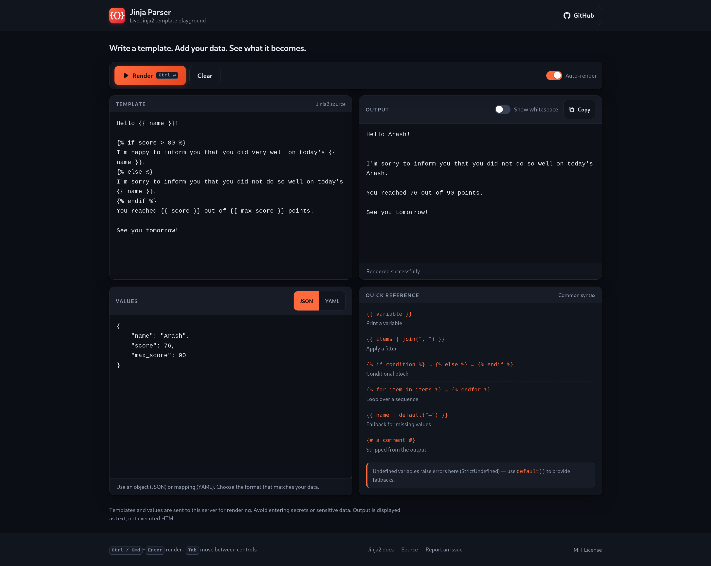

# Jinja Parser

[](https://github.com/hatamiarash7/Jinja-Parser/actions/workflows/release.yml) [](https://github.com/hatamiarash7/Jinja-Parser/actions/workflows/codeql-analysis.yml)  [](LICENSE)

A live parser for [Jinja2](https://jinja.palletsprojects.com/) templates. Paste a template, provide JSON or YAML variables, and see the rendered result instantly.



## Features

- **Live rendering** of arbitrary Jinja2 templates with JSON or YAML variables
- **Sandboxed by design** — templates are compiled in an `ImmutableSandboxedEnvironment`, so untrusted templates cannot access unsafe attributes, the filesystem, or Flask internals
- **Strict variables** — undefined variables raise an explicit error instead of silently rendering empty
- **Whitespace visualization** — optional bullet (`•`) markers for spaces
- **XSS-safe output** — rendered results are HTML-escaped before display
- **Lightweight** — a single Flask endpoint plus a static page; runs anywhere Python runs
- **Dependency-free interface** — custom CSS and vanilla JavaScript, with automatic light/dark themes and responsive editors
- **Convenient editing** — debounced auto-render, Ctrl/Cmd + Enter, plain-text copying, and a Jinja2 quick reference
- **Accessible controls** — labelled editors, visible keyboard focus, touch-sized controls, and announced rendering status

### Using the playground

The example renders on page load. Edit the template and provide matching JSON
or YAML values (an object/mapping, or `{}` when no variables are needed).
Auto-render runs after a short typing pause; turn it off to render manually
with **Render** or **Ctrl/Cmd + Enter**. Switching the format does not translate
your data: select the format matching what you pasted.

**Show whitespace** marks spaces without changing the copied output. **Copy**
copies the displayed text with its original spaces and line breaks. **Clear**
asks for confirmation before removing your work. Tab keeps its normal keyboard
navigation behavior.

Templates and values are sent to the running server for rendering. Avoid using
secrets or sensitive data. Drafts are not saved to browser storage, and rendered
HTML is shown as text, not executed.

## Install

### Local

```bash
git clone https://github.com/hatamiarash7/Jinja-Parser.git && cd Jinja-Parser
make install   # runtime dependencies
make run       # gunicorn on http://127.0.0.1:5000
```

> Python 3.13+ is required.

### Docker

```bash
docker run -d -p 8125:8125 hatamiarash7/jinja-parser
```

Or with Docker Compose:

```bash
docker compose up -d
```

Open <http://localhost:8125>.

#### Configuration

| Variable          | Default | Description                |
| ----------------- | ------- | -------------------------- |
| `WEB_CONCURRENCY` | `2`     | Number of gunicorn workers |

```bash
docker run -d -p 8125:8125 -e WEB_CONCURRENCY=4 hatamiarash7/jinja-parser
```

## API

### `GET /`

Serves the single-page UI.

### `GET /healthz`

Liveness probe. Returns `200` with `{"status": "ok"}`.

### `POST /convert`

Renders a template. Accepts form-encoded fields:

| Field         | Required | Description                                           |
| ------------- | -------- | ----------------------------------------------------- |
| `template`    | yes      | Jinja2 template source                                |
| `type`        | yes      | Variables format: `json` or `yaml` (case-insensitive) |
| `values`      | yes      | Variables as an object/dictionary                     |
| `whitespaces` | no       | `1` to replace spaces with `•`, otherwise `0`         |

Example:

```bash
curl -X POST http://localhost:8125/convert \
    -d 'template=Hello {{ name }}!' \
    -d 'type=json' \
    -d 'values={"name": "World"}' \
    -d 'whitespaces=0'
```

Response (`200`):

```json
{"rendered_output": "Hello World!"}
```

Client errors (`400`) return `{"error": "..."}` for invalid templates, malformed JSON/YAML, non-dictionary values, or rendering errors (e.g. undefined variables). Requests larger than 1 MiB are rejected with `413`. Unexpected server errors return `500` and are logged.

## Security

This service renders **untrusted** templates, so:

- Templates are compiled in an `ImmutableSandboxedEnvironment` (no unsafe attribute access, no imports, no loader)
- YAML input is parsed exclusively with `yaml.safe_load` — no arbitrary object deserialization
- Undefined variables are an error (`StrictUndefined`), not an empty string
- Rendered output is HTML-escaped and newlines become `<br />` before being returned
- Request bodies are capped at 1 MiB and gunicorn workers are restarted if a pathological template hangs one

## Development

```bash
make install-dev   # runtime + development dependencies
make test          # run the test suite with a coverage report
make coverage      # write an HTML coverage report to htmlcov/
make lint          # pylint on project files
make run-dev       # Flask development server with auto-reload
make check         # lint + test
make help          # list all targets
```

Tests live in [`test_app.py`](test_app.py) (pytest, Flask test client) and cover the full application, including SSTI and YAML-deserialization attack vectors. The test suite can be run against the local virtualenv with `make test PYTHON=.venv/bin/python`.

### Project structure

```text
app.py                  # Flask app: GET /, POST /convert, GET /healthz
templates/              # Jinja2 page templates (index + example snippets)
static/                 # CSS/JS assets (custom, dependency-free) + favicon
test_app.py             # pytest suite
Dockerfile              # OCI image (non-root, healthchecked)
docker-compose.yml      # Local Compose setup
```

## Support 💛

[](https://donatebadges.ir/donate/Bitcoin/bc1qmmh6vt366yzjt3grjxjjqynrrxs3frun8gnxrz)

[](https://donatebadges.ir/donate/Ethereum/0x0831bD72Ea8904B38Be9D6185Da2f930d6078094)

<div><a href="https://payping.ir/@hatamiarash7"></a></div>

## Contributing 🤝

Don't be shy and reach out to us if you want to contribute 😉

1. Fork it!
2. Create your feature branch: `git checkout -b my-new-feature`
3. Commit your changes: `git commit -am 'Add some feature'`
4. Push to the branch: `git push origin my-new-feature`
5. Submit a pull request

## Issues

Each project may have many problems. Contributing to the better development of this project by reporting them. 👍

## License

Released under the [MIT License](LICENSE).
